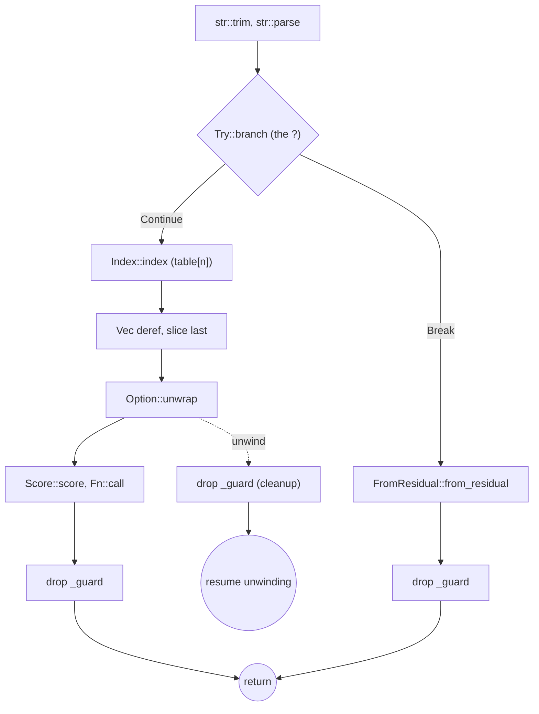

+++
title: codeflow: what rustc's MIR shows that a symbol graph doesn't
date: 2026-11-07
description: codeflow gives coding agents call trees and control-flow graphs, and on one Rust function its MIR graph shows calls and paths that two symbol graphs leave out.
+++

When a coding agent is asked "who calls this?" or "what are all the ways out of this function?", the easy tool is grep. Grep finds names, not paths. So I built [codeflow](https://github.com/coleleavitt/codeflow): call trees and per-function control-flow graphs, rendered with `file:line`, for an agent to read instead of guessing.

It has two calls:

1. `codeflow.tree(path, fn)` asks the language server for a call hierarchy (rust-analyzer, pyright, clangd, the TypeScript server, gopls and others). Minified JS bundles go through acorn.
2. `codeflow.cfg(path, fn)` builds the graph of one function from a parser or a compiler: Python `ast`, acorn for JS/TS, LLVM IR from clang at `-O0 -g` for C/C++, and rustc's MIR for Rust.

For Rust, codeflow sets a small driver as `RUSTC_WORKSPACE_WRAPPER`. The driver reads the function's MIR through `rustc_public` and writes it out as JSON. The Rust part is where the difference between a symbol graph and a compiler graph is easiest to see.

## The example

I wrote a 47-line crate with one function that does several things the source does not spell out as calls. `Guard` implements `Drop`, `Table` implements `Index<usize>`, and `Double` implements a trait `Score`:

```rust
pub fn total<S: Score>(scorer: &S, table: &Table, input: &str) -> Result<u32, ParseIntError> {
    let _guard = Guard("total");
    let n: usize = input.trim().parse()?;
    let first = table[n];
    let last = *table.rows.last().unwrap();
    let add = |x: u32| x + first;
    Ok(add(scorer.score(last)))
}
```

It has a `?` early return, a value with a destructor, an `unwrap()` that can panic, an overloaded `[]`, an auto-deref from `Vec` to a slice, a closure, and a call through a generic bound.

## What the symbol graphs list

The call hierarchy from rust-analyzer (`codeflow.tree(..., external=True)`):

```
total  lib.rs:36   [calls, depth 3, rust]
├─ Guard  lib.rs:4  (at line 37)
├─ score  lib.rs:25  (at line 42)
└─ external: Ok, last, parse, trim, unwrap
```

[codegraph](https://github.com/colbymchenry/codegraph), Colby Mchenry's project, indexes a project with tree-sitter into SQLite and serves it to agents over MCP. Its edge kinds are `contains`, `calls`, `imports`, `exports`, `extends`, `implements`, `references`, `type_of`, `returns`, `instantiates`, `overrides` and `decorates`. I ran my own Rust port of it, [codegraph-rs](https://github.com/Miasin-Labs/codegraph-rs), on the same crate:

```
Callees of "total" (2):
struct      Table      src/lib.rs:12
method      score      src/lib.rs:25
Unresolved calls (3):
  external  input.trim (38), .parse (38), add (42)
In other graphs (3):
  - Option::unwrap (method) - std core/src/option.rs:1013
  - last (function) - std core/src/slice/mod.rs:283
  - Result::Ok (enum_member) - std core/src/result.rs:562
```

Its database also has an `instantiates` edge from `total` to `Guard` (line 37); the `Table` above is a `references` edge from the signature. `codegraph callers index` and `codegraph callers drop` both answered `No callers found`. codegraph-rs also has `analyze cfg`, which re-parses the source with tree-sitter. For `total` it gives 4 blocks, and it does have the `?`: an edge `2 -> 1 (return)` from lines 37-38 to the exit.

Neither graph has the `Drop` call, the `Index` call or the deref, and neither shows that a panic in `unwrap()` still runs the destructor.

## What MIR shows

`codeflow.cfg(path, "total")` defaults to `level="source"`. The graph is still MIR, but it is tidied to read like the code:

```
B0  :37-38      calls str::trim, str::parse, <Result<usize, ParseIntError> as Try>::branch
                · let n: usize = input.trim().parse()?;   [tests input.trim().parse()?]
    ├─ Continue → B2
    └─ Break → B1
B1  :38-43      calls <Result<u32, ParseIntError> as FromResidual<Result<!, ParseIntError>>>::from_residual
    └─ → B3
B2  :38-43      calls <Table as Index<usize>>::index, [u32]::last, Option::unwrap, Score::score, Fn::call
    └─ → B3
B3  :43         return    ← B1, B2
```

`level="mir"` keeps what the source level hides: `drop _guard` on both the `Break` path (B6) and the normal path (B13), and the call `<Vec<u32> as Deref>::deref(..)` (B8) between `table[n]` and `last()`. It grows from 5 blocks to 15. With `cleanup=True` it has 17: every call in the function, from `str::trim` to `Fn::call`, gets an `unwind` edge into one block that runs `drop _guard` and then `resume unwinding`.



(Only the `unwrap` unwind edge is drawn. The other calls have the same edge.)

Item by item:

1. **`?`** is a call to `Try::branch`, a switch on `Continue`/`Break`, and a call to `FromResidual::from_residual` on the error path.
2. **`Drop`** is a `drop _guard` block on every exit, including the unwind path.
3. **`unwrap()`** is a call with an unwind edge. The panic itself is inside `Option::unwrap`; what MIR adds is the cleanup it leads to here.
4. **`table[n]`** resolves to the concrete impl, `<Table as Index<usize>>::index`, and `.last()` on a `Vec` goes through `<Vec<u32> as Deref>::deref`.
5. **The closure** is `Fn::call`. Its own graph (`total::{closure#0}`) is one block, `assert !overflow (Add)`: the `+` can panic, because overflow checks are on in a debug build.

## Where the symbol graph is the better tool

I build both kinds of tool, and the comparison is not one-sided.

- **Generic calls stay generic.** Inside `total`, MIR names `Score::score`, not `Double::score`. MIR comes before monomorphization, and `S` is a parameter. codegraph's `analyze traits` gives more here: `Score` has one implementor, `Double`, and `total -> score (via Score)`.
- **Scope and cost.** A symbol graph covers the whole repository and dozens of languages, with no build. codegraph indexed this crate in 23 ms. codeflow's Rust graphs compile the crate with a pinned nightly: the first call in a workspace takes minutes, and later calls rebuild only the crate.
- **One function at a time.** `cfg` answers "every path through this function". "Who calls this across the repository" is a call-hierarchy question, and codeflow sends it to the language server, which has the same blind spots as any symbol graph.

## Status

codeflow is public at [github.com/coleleavitt/codeflow](https://github.com/coleleavitt/codeflow). It is a Python package for my agent harness, not a standalone CLI, and it has no README yet: `SKILL.md` is the documentation. The Rust driver builds against rustc's private crates (`#![feature(rustc_private)]`), so it needs the `rustc-master` toolchain and rebuilds itself when that toolchain changes. I ran this example on `rustc 1.101.0-nightly (c6ac6ea53 2026-11-06)`. The codegraph-rs build I used is my local checkout, ahead of its public `master`. The `cfg` command and the edge kinds quoted above are also in the public tree.

## What I took from it

- **In Rust, operators and scope ends are calls.** `?`, `[]`, auto-deref and `}` all run code the source does not name.
- **A `Drop` or `Index` impl had no callers in the symbol graph.** MIR names every place they run.
- **Use both.** A symbol graph answers "who calls this" across a repository cheaply. A compiler graph answers "every path through this function", including the paths that only exist when something panics.
