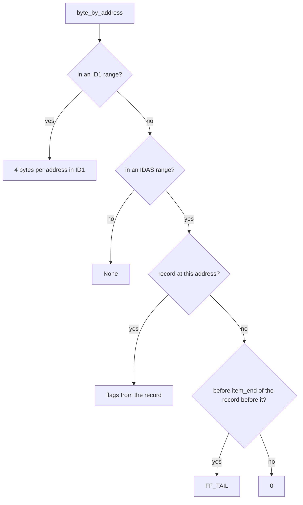

+++
title: Reading IDA 9.5 databases in Rust
date: 2026-11-07
description: IDA 9.5 changed two section headers and idb-rs stopped opening its databases; the fix also reads the flags IDA 9.1 moved out of ID1 and corrects how argument locations are decoded.
+++

An [earlier post](/writing/xtensa-decoder-apartment-wifi/) was about a binary that IDA could not read. This one is about reading IDA's own database format, from Rust.

[idb-rs](https://github.com/Vector35/idb-rs) parses IDA `.idb` and `.i64` files. It is published by Vector 35, the company behind Binary Ninja, and Binary Ninja's IDB import plugin depends on it (`plugins/idb_import/Cargo.toml` in [binaryninja-api](https://github.com/Vector35/binaryninja-api) pins tag `0.1.15`). It reads the file itself; it does not need IDA.

Databases saved by IDA 9.5 did not open. Their header says version 950, and upstream's version match ends in:

```rust
value => Err(anyhow!("Invalid IDBVersion: {value}")),
```

Adding 950 was the easy part. The header has the same layout as 9.1's. Two sections behind it do not.

## What changed in 9.5

ID1 holds the flags of every address, 4 bytes per address, grouped in ranges. NAM lists the addresses that have names. Both start with a `VA*` header, and upstream checked one field in it with `ensure!(unknown_always3 == 3)`. In 9.5 that field is 4. It is a kind, and kind 4 changes the layout:

1. **ID1 kind 4** stores `(start, end, offset)` per range instead of `(start, end)`. The `offset` is where the range's data sits in the section. The ranges are not in address order, and the space between them can hold stale data from ranges IDA moved. The reader sorts the ranges by offset, reads each one, skips the gaps, and sorts the result by address. The older `VaN` layout already worked this way, except that its gaps must be zero, so both now share one function, `read_by_offset`.
2. **NAM kind 4** adds a `u64` page size (0x2000) after the name count.

## IDAS sparse flags

The PR also fixes two gaps that already affected 9.1 to 9.4 files. The first: flags for `.bss` and `extern` addresses were missing, so the names of extern symbols did not resolve.

A 9.1+ database has six inline sections: ID0, ID1, NAM, ID2, TIL, and SEG. Upstream read the size of the sixth and never its contents; its docs called SEG "Unknown data". Since 9.1 it holds the flags of the address ranges that have no bytes in the file (`.bss`, `extern`, alignment padding). Those ranges are not in ID1 at all. The section starts with the magic `IDAS`. Its layout, in IDA's packed number encoding:

```txt
"IDAS" u32(0x5555A51D) dd(version = 0)
dd(n) n * (dq(start delta), dq(size))   ranges whose flags are stored here
dd(m) m * (dq(start delta), dq(size))   sub-ranges whose bytes have a value (0)
records: dq(address delta) dd(flags) dq(item size)
```

Instead of 4 bytes per address, it stores one record per item. A record sets the flags of its address. The next `item size - 1` bytes are tails (`FF_TAIL`) unless a later record names them. Bytes in the second list also get `FF_IVL`. `ID1Section::byte_by_address` now falls back to IDAS:



## IDA 9 argument locations

The second gap. `__usercall` function types store a location for the return value and each argument. A first byte other than `0xFF` is a short form: a register, a register pair, or the stack. `0xFF` starts an extended form, and upstream misread it:

- For one register it read the register but not the offset after it, so every later field started one value early.
- It read 64-bit stack, static, and register-relative values as one 32-bit `de`. They are two, low half first.
- A value of `0x80 | n` starts `n` scattered parts; only other values are `0x20 | ALOC_*`. Upstream took the low nibble as the location type in every case, and read each scattered part as three plain numbers instead of a full location followed by its offset and size.

Out of step, those prototypes failed to parse with a `Type::Function` error. The public `ArgLoc` type now carries what is stored: `Reg1 { reg, off }`, `Stack(i64)`, `Static(u64)`, `RRel { reg, off: i64 }`, and `ArgLocDist { loc, off, size }` for a scattered part. That is an API change, and the PR says so.

## The review round

GitHub's Copilot reviewer left seven threads on the first commit. I answered all seven in commit [`14b1e56`](https://github.com/Vector35/idb-rs/pull/61/commits/14b1e5645d8c91385cd7878b3a030d007b52ef1f):

1. **Navigation ignored IDAS.** `chunk_start`, `next_addr`, and the free-space search looked only at ID1. They now use both, and touching ranges merge: ID1 and IDAS never store touching ranges themselves, but `.data` in ID1 is often followed directly by `.bss` in IDAS.
2. **Iterators ignored IDAS.** `all_bytes` and `all_bytes_no_tails` now walk both in address order. IDAS bytes are produced one lookup at a time, so a large `.bss` is never materialized.
3. **Unchecked additions.** A range near `u64::MAX` could panic or wrap. They use `checked_add` now, with a unit test.
4. **Unbounded recursion.** A scattered part could itself be scattered, without limit. IDA doesn't allow that, so a nested one is now an error, with a unit test.
5. **Adjacent ranges rejected.** The overlap check `seg1.end >= seg2.start` rejected half-open ranges that share an endpoint. It is `>` now.
6. **Whole ID1 body buffered.** The shared reader now reads ranges in file-offset order and skips gaps as a stream.
7. **Quadratic tail lookups.** Each implicit tail walked back to its item head. Each record now stores the end of the item that covers the bytes after it, computed once, so a lookup is one binary search.

The rewrite turned up two older bugs. `rangeset_t_prev_range` returned the next range. `find_free_chunk` returned the free size instead of the address, and indexed past the end of the range list when the start address was after the last range.

## Status

The [PR](https://github.com/Vector35/idb-rs/pull/61) is open, with two commits, since 2026-10-28. Review is requested from a member of the Vector35 organization; so far the only review is Copilot's. On my branch, `cargo test` passes 55 tests: the 53 that existed and the two new ones.

CI on the first commit passed `cargo test` and `cargo fmt` and failed the license check. That check runs `cargo-about`, and the repository's `about.toml` accepts only Apache-2.0, MIT, and Unicode licenses. There is no `Cargo.lock`, so CI resolved `zstd = "0.13.3"` to `zstd-safe` 7.3.0 and `zstd-sys` 2.1.2, which are BSD-3-Clause. `zstd-safe` was MIT OR Apache-2.0 up to 7.2.4; 7.3.0 came out on 2026-09-04. The PR does not touch `Cargo.toml`. CI for the second commit has not run; GitHub marks it `action_required`, waiting for approval.

Testing beyond the unit tests is in the PR description. 237 local databases, IDA 6.x through 9.5, now decode. On nine of them, function bounds, names, NAM lists, and per-byte flags match IDA 9.5's own answers through IDAlib. One differed on 41 sampled bytes that IDA rewrites while opening; after IDA re-saved it, those matched too.

## What I took from it

- **A constant in a parser is a guess.** `unknown_always3` was a kind field. Checking it was still right: 9.5 files failed loudly instead of being misread.
- **Missing data can be in a section nobody reads.** The `.bss` flags were in the file all along, in a section whose size the reader already parsed.
- **Snapshots only cover what the fixtures contain.** Every argument location in the existing snapshots was `None`, so the `0xFF` form was never tested.
