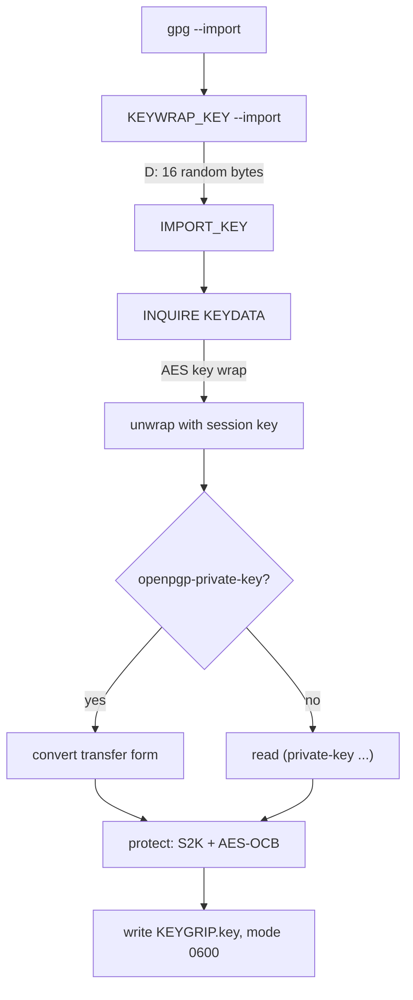
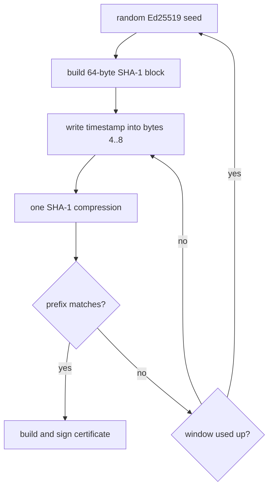

+++
title: Replacing gpg-agent with my own Rust agent
date: 2026-11-07
description: keyoxide, my no-prompt SSH and GPG agent, could only sign until it cost me a freshly generated key; now it serves the rest of gpg-agent's protocol.
+++

On my laptop, `gpg` and `ssh` do not talk to gpg-agent or ssh-agent. They talk to [keyoxide](https://github.com/coleleavitt/keyoxide), an agent I wrote in Rust. Until 2026-11-07 it could sign, but not import, decrypt, or generate keys. That day I generated a new OpenPGP key and piped it straight into `gpg --import`:

```
found after 26s
fingerprint DEC2 3202 3B18 …  (never published)
gpg: key C07CF659B1B04CCB: public key "Cole Leavitt <cole@unwrap.rs>" imported
gpg: error getting the KEK: Unknown IPC command
gpg: error reading '[stdin]': Unknown IPC command
gpg:               imported: 1
```

gpg asked the agent for a key-wrapping key, the agent did not know the command, and the secret key existed only in the pipe. It was never published; I deleted the public half and implemented the rest of the protocol.

A note on names: this keyoxide is not [Keyoxide](https://keyoxide.org), the identity-proof service. My key also carries a Keyoxide proof (a `proof@ariadne.id` notation pointing at a GitHub gist). The two projects are unrelated.

## Why my own agent

The README states the goal: load the existing OpenSSH and GnuPG private keys at startup, decrypt them once with a configured passphrase, and serve the standard agent sockets without prompting. The cost is stated too: decrypted keys sit in memory, and anything that can reach the sockets can sign. I accept that on one trusted machine. An OpenRC user service starts it with `--replace`, which stops the real gpg-agent and takes over the socket that `gpgconf --list-dirs agent-socket` reports.

## What gpg says to an agent

gpg talks to its agent over Assuan: one command per line, answered by `OK`, `ERR`, data lines (`D`), status lines (`S`), or an `INQUIRE` when the agent needs more data. This is a real signing exchange with keyoxide in a throwaway GnuPG home (binary signature bytes elided):

```
OK Pleased to meet you, keyoxide speaking
GETINFO version
D 2.5.20
OK
SIGKEY 48DD3C8A31A3C90F2CF3041E3F920B08AEFA11E8
OK
SETHASH --hash=sha256 5891B5B522D5DF086D0FF0B110FBD9D21BB4FC7163AF34D08286A2E846F6BE03
OK
PKSIGN
D (7:sig-val(5:eddsa(1:r32:…)(1:s32:…)))
OK
GETINFO cmd_has_option IMPORT_KEY mode1003
ERR 67109120 option not supported
```

gpg hashes the data itself; the agent only signs the digest for the key named by its keygrip. The last line matters: gpg asks which options the agent supports and then uses them, so keyoxide answers yes only for options it really implements.

## The commands it serves now

The first version had `PKSIGN`, `HAVEKEY`, `KEYINFO`, `GETINFO` and a few setup commands. [PR #2](https://github.com/coleleavitt/keyoxide/pull/2) added the rest of what gpg uses:

- **`PKDECRYPT`** for RSA and ECDH, including GnuPG 2.5's `--kem=PGP`. In that form the agent runs the RFC 6637 KDF and unwraps the session key itself. In my test run, GnuPG 2.5.20 used `--kem=PGP` for Curve25519 and P-256 keys and the classic form for RSA.
- **`KEYWRAP_KEY` + `IMPORT_KEY`**, the pair that failed above. The agent hands out 16 random bytes, and gpg sends the secret key AES-key-wrapped with them.
- **`GENKEY`** for Ed25519, Curve25519, P-256/P-384 and RSA 2048-8192, **`EXPORT_KEY --openpgp`**, and **`PASSWD`**.



Not supported: smartcard keys and `--export-options mode1003`.

## Key files gpg-agent can still read

keyoxide stores keys where gpg-agent does, in `private-keys-v1.d/<KEYGRIP>.key`, and in the same format. Each key is a `protected-private-key` S-expression: the secret parameters are encrypted with AES-128 in OCB mode, under a key from OpenPGP's iterated and salted SHA-1 S2K (count 131,585,024). The public parameters and the `protected-at` timestamp are bound in as associated data. Files are written with mode 0600 and renamed into place. Every key shares keyoxide's one passphrase, so `PASSWD` re-protects a key under it, and `keyoxide passwd` moves all keys to a new one.

Reading GnuPG's files properly took two fixes. The first version guessed a key's curve by searching the file text for `Ed25519` or `nistp256`, so it skipped my Curve25519 key with `unknown ECC curve`. It now parses the S-expression. And the extended format folds the `Key:` value across lines, where a fold can split a token, so the pieces must be joined without separators, as GnuPG's `common/name-value.c` does.

## The SSH side

The SSH agent signs with RSA (SHA-256/512), Ed25519 and ECDSA P-256/P-384 keys from `~/.ssh`. OpenSSH 8.9 and later send a `session-bind@openssh.com` extension request when they use the agent to authenticate. keyoxide used to close the connection on any unknown request type. It now answers `SSH_AGENT_FAILURE` and keeps the connection open. RSA requests without a SHA-2 flag get the SHA-1 `ssh-rsa` signature the protocol defines. `ssh-add` add and remove requests fail, because keys load at startup.

## Testing against the real tools

`contrib/e2e.sh` runs real GnuPG and OpenSSH against the built binary. It uses a throwaway `HOME` and `GNUPGHOME`, its own runtime directory for sockets, and `pinentry-program /bin/false`, so it cannot touch my keys or the running agent. Before generating its fixture keys, it refuses to run if the test home maps to the real agent socket. It has 27 checks: signing and decryption with Ed25519/Curve25519, RSA and P-256 keys, imports under three passphrase cases, `GENKEY`, `PASSWD`, an export imported by the real gpg-agent, the SSH cases above, and `keyoxide passwd`. All 27 pass, and so do the 64 Rust tests.

## The vanity key

My key's fingerprint is `DEC2 3202 3B77 3F66 98EA 54F1 1DFB 3167 910E 6193`. I chose the first nine hex digits, and [pgp-vanity](https://github.com/coleleavitt/pgp-vanity) searched for the rest.

A v4 fingerprint is the SHA-1 of `0x99`, a two-byte length, and the public-key packet body. For an Ed25519 key that is 54 bytes, which fits in one 64-byte SHA-1 block. Bytes 4 to 7 hold the creation timestamp. So pgp-vanity takes a fresh random seed from Sequoia's CSPRNG, builds the block once, and then tries every timestamp in the last 30 days (2,592,000 values) with one SHA-1 compression each. The secret key is never weakened; only its creation date moves. It runs one search thread per CPU, and before searching it checks its fingerprint code against Sequoia's.



Nine hex digits take 16⁹ ≈ 6.87 × 10¹⁰ tries on average. On 24 threads the search ran at 757 to 796 million tries per second, about 90 seconds on average. The lost key took 26 seconds; the one I kept took 7. Its creation date reads 2026-10-18, though I made it on 2026-11-07.

## Status

- keyoxide: PR #2 merged on 2026-11-07, and it runs on my laptop as an OpenRC user service. I have tested it only with GnuPG 2.5.20.
- pgp-vanity: one commit on GitHub, not published to crates.io.

## What I took from it

- **A half-implemented agent fails at the worst moment.** Write a new secret key to a file before you import it anywhere.
- **A vanity prefix proves nothing.** Nine digits cost one desktop about 90 seconds on average. Compare the whole fingerprint.
- **Test an agent against the real client.** An isolated GnuPG home with no pinentry made all 27 checks safe to run on my own machine.
