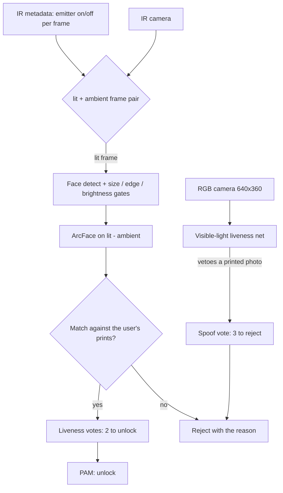

+++
title: Face unlock for Linux, done the way Windows Hello does it
date: 2026-11-07
description: I wanted my ThinkPad's infrared camera to log me in like Windows Hello, with real liveness detection, so I wrote it in Rust and plugged it into PAM.
+++

My ThinkPad P16 Gen 3 has an infrared camera and an IR emitter, the same hardware Windows uses for Windows Hello face unlock. On Linux that hardware mostly sits idle. I wanted the real thing: look at the laptop, and it logs me in. Not a webcam photo match, which a printed picture defeats, but face unlock with liveness detection. So I wrote [linux_hello](https://github.com/coleleavitt/linux_hello) in Rust.

## Why the IR emitter matters

A plain webcam login compares a face to a stored photo. Hold up a printout and it unlocks. The whole point of the IR hardware is to make that hard.

The emitter lights every other frame. The camera's metadata node says which frames are lit, so each lit frame can be paired with the ambient frame right next to it, under 300 ms apart. Recognition runs on `lit − min(lit, ambient)`: the light the emitter *added*, with the room's own IR subtracted out. A screen emits no IR and shows no face to the IR camera at all, so it never gets past the first gate.

## The pipeline

A few things I took from studying how Windows Hello behaves:

- **Recognise first, then check liveness.** Like Windows, the user is identified first (four enrolled prints, best one above the threshold). Only after that do liveness votes count. A well-lit frame pair is a live vote; the visible-light model can veto it and turn it into a spoof vote. Two live votes unlock; three spoof votes reject.
- **Gates before models.** The face has to be at least 72 px wide, away from the frame edges, and in a sane brightness band. The emitter has to add real IR and the ambient IR has to stay low. Cheap checks throw out bad frames before any neural net runs.
- **1:1 verification.** A face is only ever compared against the template of the account being unlocked, so one enrolled face can never open another account.
- **The template follows you.** Enrollment keeps 16 prints taken while you move your head a little. After a borderline-but-correct unlock the frame is folded back in, so the template tracks slow changes like a new haircut or glasses.

Enrollment estimates a false-accept rate and only calls it done under 1e-5. Every failure says *why* it failed: too dark, too far, at the edge, occluded, not frontal, not live. Debugging a face unlocker you can't see into is miserable, so the feedback was worth the effort.

## PAM, kept small

The matching, the models, and the camera handling all live in one daemon. The PAM module, `pam_linux_hello.so`, has no machine-learning code in it at all. It opens a Unix socket to the daemon and asks one question: is this the user? That keeps the thing that sits in the authentication path tiny and easy to reason about, with the heavy code on the other side of the socket.

There's also a greetd greeter, `hello-greeter`, with a Windows Hello-style "Looking for your face…" sign-in and lock screen.

## Where it stands

I use it to `sudo` and to unlock the screen every day on this one laptop (a Realtek IR camera, USB `30c9:00f3`, on Gentoo). It is tuned to my hardware, not a polished product for every webcam. The Windows Hello model conversion is an optional second opinion: without those models it runs on open face-recognition models alone. The code and the notes on the capture and liveness work are in the [repo](https://github.com/coleleavitt/linux_hello).
