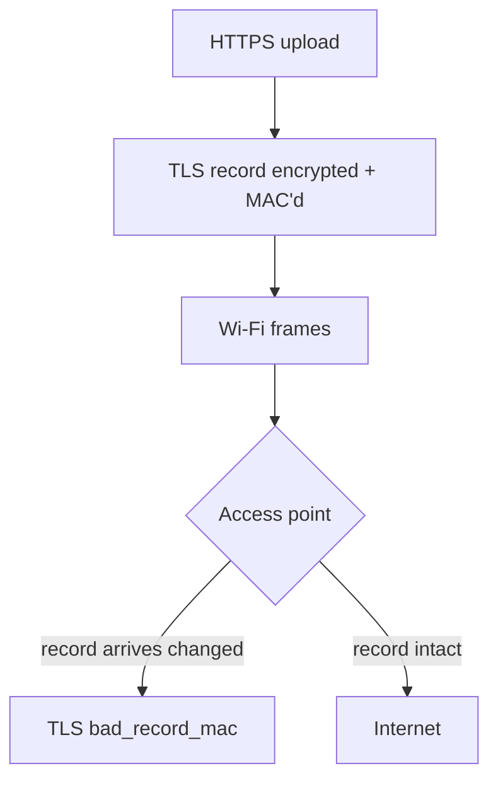

+++
title: My apartment Wi-Fi was corrupting my uploads, so I wrote an Xtensa decoder
date: 2026-11-07
description: Chasing a TLS error on my building's Wi-Fi down into the access point's firmware, building an Xtensa decoder when the usual tools couldn't read the chip, and checking it against LLVM on every possible input. With a live demo.
+++

Large HTTPS uploads on my apartment's Wi-Fi kept failing with `bad_record_mac`. That is TLS saying the data arrived different from how it was sent: the encrypted record's checksum did not match. It happened on big uploads, not small requests, and only on this network.

A corrupted TLS record is not a "flaky Wi-Fi" problem. The radio either delivers a frame or it does not; it does not quietly flip bytes inside one and hand it up as good. So something between my machine and the far end was changing the bytes after they were encrypted and before they were checked. That pointed at the path through the access point.

## Isolating it

First I made the failure repeatable: a scripted large upload, run over and over, counting the `bad_record_mac` failures. Then I changed one thing at a time. The rate tracked a single access point in the building. Reassociating to a different AP made it go away; coming back brought it back. Rebooting that AP cleared it for a while. That is a controlled experiment, not a hunch: the fault lived in one box, and it looked like memory getting corrupted on the transmit path.



To say anything more precise, I had to read the firmware.

## IDA doesn't speak Xtensa

The AP runs on a Qualcomm QCA4019, and its Wi-Fi firmware runs on a Tensilica **Xtensa** core. That is the catch. Xtensa is a configurable architecture, nothing like x86 or ARM, and IDA Pro has no native processor module for it. Neither does Ghidra, out of the box. The disassemblers I reach for every day simply could not read this binary.

What they produced was worse than nothing. The image was stripped, and Xtensa instructions are variable length, some 16-bit and some 24-bit. A disassembler that loses alignment on one instruction decodes every instruction after it wrong, and there is no obvious sign it has gone off the rails. I could not trust a single line of it, and I needed to reason about memory ordering down to the individual instruction.

So I stopped fighting the tools and wrote my own decoder. That turned out to be a real project in itself, not an afternoon's hack.

## Building it from LLVM's own definitions

I did not hand-write an instruction table from a PDF. LLVM already has a precise, machine-readable description of Xtensa in its TableGen files: every instruction format, every field, every encoding. My first decoder, [xtensa-decoder](https://github.com/coleleavitt/xtensa-decoder), was Python I wrote while reading those files. It covered the instructions I needed, parsed the Qualcomm firmware header, and its output looked right.

Looking right is exactly what I had blamed IDA for. So I later checked it properly against `llvm-mc`, LLVM's own disassembler, on every 16-bit encoding and a sample of 20,000 24-bit ones. It agreed on 61% of the valid 16-bit instructions and 42% of the 24-bit ones. Some `bgez` branches came out as unconditional `j` jumps, and `addi.n` and `movi.n` read their fields in the wrong order. Nothing in its output said so.

The second version doesn't read the TableGen files by eye:

1. `llvm-tblgen -dump-json` turns LLVM 22.1.8's Xtensa target into JSON.
2. A script generates the decoder's instruction table from that JSON: 283 instructions, each a mask, a match value and its operand fields.
3. Operand decoding follows LLVM's `XtensaDisassembler.cpp` and `XtensaInstPrinter.cpp`, and the valid special and user registers come from asking `llvm-mc` about each one.
4. The output is compared with `llvm-mc --triple=xtensa -mcpu=esp32` on **every possible input**: all 65,536 two-byte words, all 10,485,760 three-byte words that don't start with a 16-bit instruction, and the 977,920 that look like one but aren't.

All 11,529,216 decode identically: the same valid or invalid verdict, the same mnemonic, the same operands. That decoder is in Rust, in [this site's repository](https://github.com/coleleavitt/unwrap-rs/tree/dev/xtensa-dis).

## Try it

The same Rust decoder runs below as WebAssembly, in your browser. The example is a function I assembled with `llvm-mc`: it sums an array of words using Xtensa's zero-overhead `loop`. Change the bytes or the base address and the listing follows.

```xtensa-demo
base 40080000
36 41 00 0c 04 76 83 05 58 02 5a 44 4b 22 2d 04 1d f0
```

It decodes the instruction set of LLVM's `esp32` processor: the base ISA plus options such as the 16-bit density instructions, windowed registers, zero-overhead loops, MAC16, single-precision floating point and booleans. Bytes that decode to nothing show as `.byte`.

## What I found

My first pass through the firmware used the Python decoder, so those notes have to be checked again with this one. Whatever holds up stays off this blog until the vendor has it and has had time to fix it.

The decoders, though, are tools, and they're public. The lesson is the one I keep relearning: when the tool can't answer the question, and the question matters, build the tool. Then check it against something you trust, all of it, because a decoder that is quietly wrong is worse than none.
