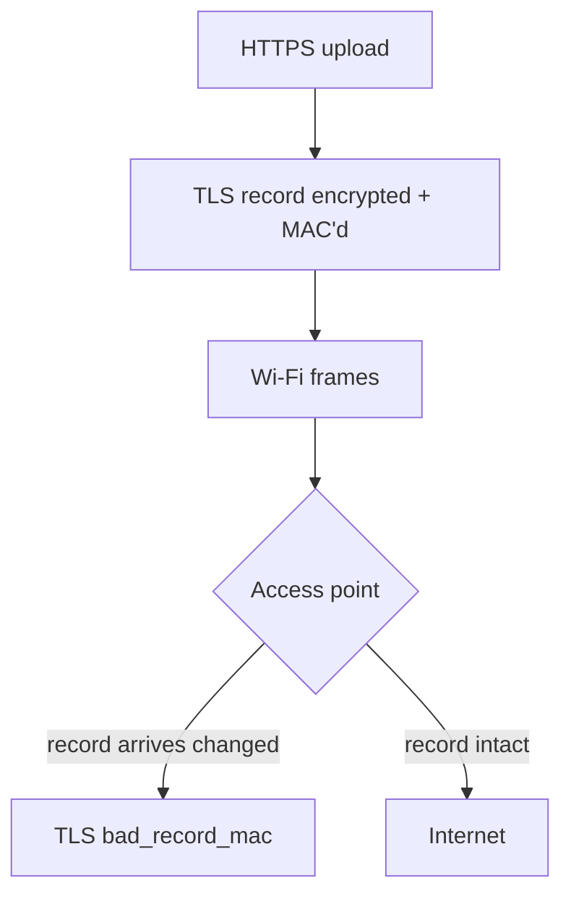

+++
title: My apartment Wi-Fi was corrupting my uploads, so I wrote an Xtensa decoder
date: 2026-11-07
description: Chasing a TLS error on my building's Wi-Fi down into the access point's firmware, finding that the usual tools couldn't read the chip, and building a decoder from LLVM's own definitions.
+++

Large HTTPS uploads on my apartment's Wi-Fi kept failing with `bad_record_mac`. That is TLS saying the data arrived different from how it was sent: the encrypted record's checksum did not match. It happened on big uploads, not small requests, and only on this network.

A corrupted TLS record is not a "flaky Wi-Fi" problem. The radio either delivers a frame or it does not; it does not quietly flip bytes inside one and hand it up as good. So something between my machine and the far end was changing the bytes after they were encrypted and before they were checked. That pointed at the path through the access point.

## Isolating it

First I made the failure repeatable: a scripted large upload, run over and over, counting the `bad_record_mac` failures. Then I changed one thing at a time. The rate tracked a single access point in the building. Reassociating to a different AP made it go away; coming back brought it back. Rebooting that AP cleared it for a while. That is a controlled experiment, not a hunch: the fault lived in one box, and it looked like memory getting corrupted on the transmit path.

To say anything more precise, I had to read the firmware.

## IDA doesn't speak Xtensa

The AP runs on a Qualcomm QCA4019, and its Wi-Fi firmware runs on a Tensilica **Xtensa** core. That is the catch. Xtensa is a configurable architecture, nothing like x86 or ARM, and IDA Pro has no native processor module for it. Neither does Ghidra, out of the box. The disassemblers I reach for every day simply could not read this binary.

What they produced was worse than nothing. The image was stripped, and Xtensa instructions are variable length, some 16-bit and some 24-bit. A disassembler that loses alignment on one instruction decodes every instruction after it wrong, and there is no obvious sign it has gone off the rails. I could not trust a single line of it, and I needed to reason about memory ordering down to the individual instruction.

So I stopped fighting the tools and wrote my own decoder. That turned out to be a real project in itself, not an afternoon's hack.

## Building it from LLVM's own definitions

I did not hand-write an instruction table from a PDF. LLVM already has a precise, machine-readable description of Xtensa in its TableGen files: every instruction format, every field, every encoding. I sparse-cloned the relevant parts of LLVM, read those definitions, and built a decoder straight from them. Then I validated it against `llvm-mc`, LLVM's own assembler: decode a stream, re-assemble it, and check that the bytes come back identical. When your decoder agrees with the reference assembler instruction for instruction, you can trust what it tells you.

The result is [xtensa-decoder](https://github.com/coleleavitt/xtensa-decoder): a complete Xtensa ISA decoder in Python, covering the core ALU, loads and stores, branches, the windowed call instructions, the MAC16 DSP ops, the narrow 16-bit encodings, and, importantly for this hunt, the memory-barrier instructions. It parses the Qualcomm firmware header format, and it can scan an image for a specific pattern: stores to DMA descriptor memory that are not followed by the barrier that would make the write visible to the hardware. That is the shape of a bug that corrupts packets on the way out.

## What I found, and where it went

With a decoder I could trust, I could finally trace the transmit path through the firmware and reason about which stores were ordered against the DMA engine and which were not. The specifics of what I found went to the chip and access-point vendors as a security report, not onto this blog. Undisclosed findings in shipping hardware stay private until the people who can fix them have had their chance.

The decoder, though, is just a tool, and it's public. The lesson is the one I keep relearning: when the tool can't answer the question, and the question matters, build the tool. LLVM had already done the hard, exact part. I just had to read it.
